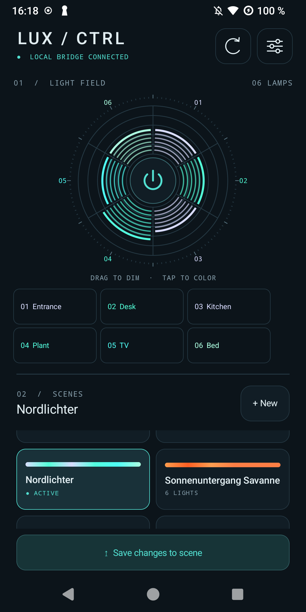

<p align="center"></p>
<h1 align="center">Lux / Ctrl</h1>
<p align="center">A local instrument for your Hue lights.</p>
<p align="center">
  <a href="https://codeberg.org/k4r/lux-ctrl/releases"></a>
  
  
</p>
<p align="center"></p>

A small, dark Android app for Philips Hue, built from [SPEC.md](docs/SPEC.md) with Kotlin and native Android views. No accounts, cloud calls, analytics, ads, or third-party runtime libraries. All icons and graphics are drawn in the project; the badges are rendered by shields.io.

## Controls

- **Light field:** each named slice is a lamp. Drag outward to brighten, inward to dim; reaching zero turns it off. Release to send the change. Tap a slice for a color disc: the outer ring chooses hue; the inner disc blends saturation and brightness. White temperature remains available on supported lamps. Edits apply as you make them. The heading shows the active scene.
- **Power:** tap the center to switch all bridge lights off; when all are off, tap to turn them on.
- **Scenes:** a three-column grid. Tap to activate; hold to rename or delete. Each palette comes from the scene’s stored lamp colors. Changes sync with the Hue bridge and other Hue apps.
- **Save:** the header’s disk icon, beside refresh and settings, opens a name dialog. With a scene active, the field is prefilled and saving overwrites that scene (renaming it if you change the name). With no scene active, saving creates a new scene from all lamps.
- **Landscape:** scenes move left and the light field moves right. The color disc opens from any slice and adapts to landscape; it supports keyboard and accessibility adjustments.

## Connect

Install the APK, open the settings icon, and enter your bridge’s private IPv4 address and API key, and choose how often lamps refresh. The phone must be on a network that can reach the bridge; internet access is unnecessary. Android 17+ requests [local-network permission](https://developer.android.com/privacy-and-security/local-network-permission).

Credentials stay in the app’s private storage, excluded from backups and device transfers. They are never bundled in the APK or committed. This version uses the **local Hue v1 HTTP API**, tested with a first-generation BSB001 bridge; HTTPS-only bridges are not supported. Use a trusted local network. Refresh reloads lamps and scenes; lamps also refresh at the interval chosen in settings (10 seconds by default) while the app is visible.

## Build

Open this folder in Android Studio, or use JDK 17+ (tested with JDK 25), Android SDK 37, and the included Gradle wrapper:

```sh
./gradlew :app:assembleDebug :app:testDebugUnitTest :app:lintDebug
adb install -r app/build/outputs/apk/debug/app-debug.apk
```

For an optimized build, `./gradlew :app:assembleRelease` shrinks and minifies with R8 and writes the installable, debug-signed `app/build/outputs/apk/release/lux-ctrl-0.1.2.apk`. No keystore setup is required.

Minimum Android: 7.0 / API 24. Compile/target: API 37. Gradle: 9.6.0; Android Gradle Plugin: 9.4.1. Only the unit tests add a library (JUnit); production uses Kotlin’s standard library and Android APIs. Initial build dependencies need internet; cached builds work with `--offline`.

An optional hardware test exercises the actual Kotlin bridge client, including lamp writes, scene create/rename/overwrite/recall/delete, and global power. It briefly changes lights, creates only a temporary scene, then restores the original lamp states. Configure the debug app first:

```sh
./gradlew :app:assembleDebugAndroidTest
adb install -r app/build/outputs/apk/androidTest/debug/app-debug-androidTest.apk
adb shell am instrument -w -e live true app.luxctrl.test/app.luxctrl.BridgeSmokeInstrumentation
```

See the [color disc](docs/screenshot-color-disc.png), [verification notes](docs/verification.md) and the [landscape screenshot](docs/screenshot-landscape.png).
